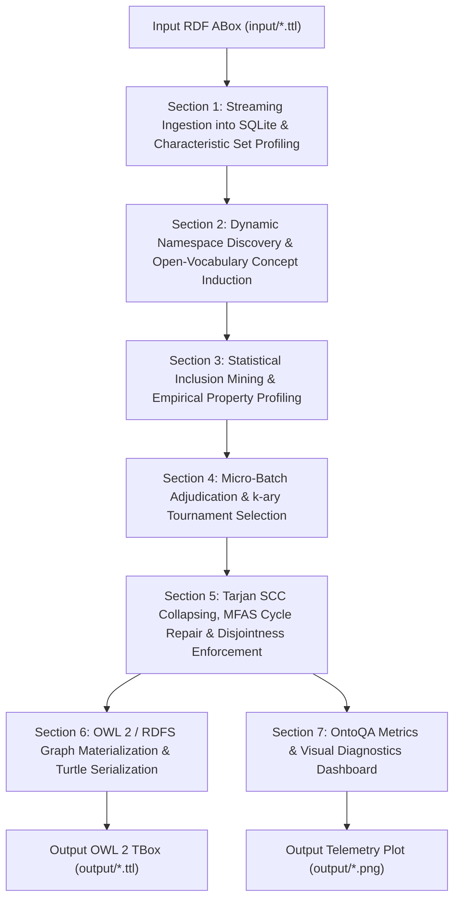

# Comprehensive Cell-by-Cell Explanation of `ABox2TBox.ipynb`

This document provides an exhaustive, cell-by-cell architectural, mathematical, and algorithmic explanation of the **ABox-to-TBox Ontology Induction Pipeline** ([`ABox2TBox.ipynb`](file:///home/miskat/ABOX2TBOX/ABox2TBox.ipynb)).

---

## 1. High-Level Architecture & Multi-Domain Pipeline

The pipeline induces a formal, logically consistent **OWL 2 / RDFS Terminological Box (`TBox.ttl`)** from any arbitrary instance-level RDF assertion graph (**`ABox.ttl`**). It combines statistical graph mining, characteristic set clustering, open-vocabulary concept induction, graph-theoretic consistency repair, and neuro-symbolic payload auditing into an automated 8-stage workflow.



The pipeline is **domain-agnostic and fully parameterized**: it can run on university datasets, e-commerce product catalogs, hospital clinical records, enterprise human resource graphs, or financial banking networks without any code modification.

---

## 2. Cell-by-Cell Detailed Breakdown

### Cell 0: Notebook Title
- **Type:** Markdown
- **Content:** `# ABox-to-TBox Ontology Induction Pipeline`
- **Purpose:** Declares the notebook's scope: an automated, generalizable pipeline for inducing formal terminological schemas from instance data.

---

### Cell 1: Section 0 Header
- **Type:** Markdown
- **Content:** `## Section 0: Environment Setup, Hyperparameters & Reproducibility Seeds`
- **Purpose:** Demarcates runtime initialization, hyperparameter configurations, and global telemetry audit logging.

---

### Cell 2: Section 0.0 — Install Required Dependencies
- **Type:** Code
- **Code:**
  ```python
  %pip install rdflib networkx matplotlib pandas numpy requests ollama
  ```
- **Purpose:** Provisions required libraries in the running kernel:
  - `rdflib`: Parsing, namespace management, graph querying, and Turtle serialization.
  - `networkx`: Directed graph algorithms (Tarjan SCC, simple cycles, transitive reduction).
  - `matplotlib`, `pandas`, `numpy`: Numerical analysis, metrics computation, and telemetry visualization.
  - `ollama`: Official Python SDK for local LLM inference daemon communication.

---

### Cell 3: Section 0.1 — Imports, Reproducibility Seeds & Global Configuration
- **Type:** Code
- **Key Components:**
  - **Imports:** Standard collections (`Counter`, `defaultdict`), itertools, typing, graph libraries (`rdflib`, `networkx`), numerical libraries, and `ollama`.
  - **Deterministic Seeds:** Sets `seed_value = 42` for Python `random` and NumPy to guarantee reproducible execution.
  - **Parametric Hyperparameters (`CONFIG`):**
    - `OLLAMA_BASE_URL`: Local model endpoint (`"http://localhost:11434"`).
    - `MODEL_ADJUDICATOR`: Decision model (`"tev1:0.8b"`).
    - `MAX_PAYLOAD_TOKENS`: Maximum token ceiling per model payload (`1500`).
    - `MICRO_PROMPT_MAX_TOKENS`: Individual prompt ceiling (`400`).
    - `TAU_SUB`: Subsumption conditional containment threshold (`0.15`).
    - `TAU_SIG`: Jaccard similarity significance threshold (`0.40`).
    - `EPS_DISJ`: Disjointness instance overlap ratio ceiling (`0.005`).
    - `THETA_PROB`: Decision probability acceptance gate (`0.70`).
    - `THETA_CONF`: Confidence score acceptance gate (`0.65`).
    - `THETA_SCORE`: Ontological rigor score gate (`1.80`).
    - `THETA_NOUL`: Algebraic property characteristic gate (`0.80`).
    - `DELTA_DEADBAND`: Deadband separation margin for mutex properties (`0.15`).
    - `TOURNAMENT_B`: Bracket size for $k$-ary tournament selection (`15`).
    - `EXPORT_STRICT_OWL2_DL`: Boolean toggle for PROV-O axiom reification metadata (`False`).
    - `ABOX_PATH`: Dynamically read from `os.environ.get("ABOX_INPUT_PATH", "input/ABox.ttl")`.
    - `TBOX_PATH`: Dynamically read from `os.environ.get("TBOX_OUTPUT_PATH", "output/TBox.ttl")`.
  - **Reusable Utilities:**
    - `local_name(uri: str) -> str`: Robustly strips namespace prefixes to isolate entity identifiers.
    - `audit_payload_tokens(payload, endpoint, status, max_ceiling) -> int`: Serializes JSON request payloads, calculates token estimates ($\approx \text{len} / 3.8$), validates the $\le 1,500$ token ceiling assertion, and logs to `PAYLOAD_TOKEN_AUDIT_LOG`.
- **Exported Namespace:** `CONFIG`, `seed_value`, `PAYLOAD_TOKEN_AUDIT_LOG`, `TOKEN_AUDIT_LOG`, `EXPORT_STRICT_OWL2_DL`, `local_name`, `audit_payload_tokens`.

---

### Cell 4: Section 0.2 — Model Client Configuration
- **Type:** Code
- **Key Function:** `init_ollama_client(endpoint_url: str) -> tuple[ollama.Client, list[str]]`
- **Purpose:** Initializes the official `ollama.Client` bound to the configured base URL and queries locally available models via `client.list()`. Gracefully catches offline daemon exceptions without crashing.
- **Exported Namespace:** `ollama_client`, `available_model_names`, `active_adjudicator_model`, `max_allowed_tokens`.

---

### Cell 5: Section 1 Header
- **Type:** Markdown
- **Content:** `## Section 1: Scalable ABox Ingestion & Characteristic Set Profiling`
- **Purpose:** Introduces relational triple streaming and statistical predicate signature profiling for untyped entities.

---

### Cell 6: Section 1.1 — Streaming Parse of ABox.ttl into SQLite Relational Index
- **Type:** Code
- **Key Function:** `ingest_abox_to_sqlite(abox_path: str) -> tuple[sqlite3.Connection, list[str], set[str], list[str], int]`
- **Technical Operation:**
  1. Parses the input RDF Turtle graph from `CONFIG["ABOX_PATH"]`.
  2. Creates an indexed in-memory SQLite store:
     `triples(subject TEXT, predicate TEXT, object TEXT, is_literal INTEGER)`
     with B-tree indices on `subject`, `predicate`, and `object`.
  3. Bulk-inserts all parsed triples in a single batch transaction.
  4. Identifies all unique subjects, explicit instances with asserted `rdf:type`, and untyped subjects.
- **Exported Namespace:** `conn`, `cur`, `all_subjects`, `typed_subjects`, `untyped_subjects`, `total_triple_count`.

---

### Cell 7: Section 1.2 — Characteristic Set Profiling & 64-bit Signature Hashing
- **Type:** Code
- **Key Function:** `profile_characteristic_sets(cur: sqlite3.Cursor, entities: list[str]) -> tuple[dict, dict, dict]`
- **Technical Operation:**
  1. For each untyped entity, queries all outgoing object predicates, outgoing literal predicates, and incoming predicates.
  2. Constructs a normalized signature string: `out_preds|in_preds`.
  3. Computes a 64-bit BLAKE2b cryptographic hash (`digest_size=8`).
  4. Groups entities with matching hashes into structural equivalence clusters via `defaultdict(list)`.
- **Exported Namespace:** `untyped_profiles`, `cs_hashes`, `hash_to_entities`.

---

### Cell 8: Section 2 Header
- **Type:** Markdown
- **Content:** `## Section 2: Open-Vocabulary Concept Induction for Untyped Entities`
- **Purpose:** Introduces statistical open-vocabulary concept synthesis and dynamic ontology namespace discovery.

---

### Cell 9: Section 2.1 — Concept Synthesis & Relational Type Materialization
- **Type:** Code
- **Key Functions:**
  - `detect_dominant_namespace(cur: sqlite3.Cursor) -> str`: Analyzes subject and predicate URIs in SQLite to discover the dominant domain IRI prefix (e.g., `http://example.org/univ#`, `http://example.org/ecommerce#`, `http://example.org/hospital#`).
  - `synthesize_concept_from_signature(pred_names: list[str], cluster_hash: str) -> tuple[str, str]`:
    - Fully domain-agnostic concept naming.
    - Strips common relation prepositions (`has`, `is`, `of`, `to`, `by`, `with`).
    - Uses camelCase regex tokenization (`re.findall(r"[A-Z]?[a-z]+|[A-Z]+(?=[A-Z][a-z]|\d|\W|$)", p)`) to extract semantic head nouns.
    - Ranks extracted tokens by frequency across incoming and outgoing predicates to synthesize a valid PascalCase OWL 2 class identifier.
    - Provides guaranteed cluster-hash fallback if no tokens pass length filters.
  - `materialize_induced_concepts(...)`: Resolves collisions, assigns full URIs using the detected namespace, and inserts `rdf:type` assertions into SQLite for all untyped entities.
- **Exported Namespace:** `detected_namespace`, `UNIV_NS`, `DOMAIN_NS`, `induced_classes`.

---

### Cell 10: Section 3 Header
- **Type:** Markdown
- **Content:** `## Section 3: Candidate Axiom Generation & Graph Pruning`
- **Purpose:** Identifies candidate taxonomic hierarchies, candidate disjointness pairs, and property characteristics.

---

### Cell 11: Section 3.1 — Statistical Inclusion Matrix Mining
- **Type:** Code
- **Key Functions:**
  - `build_class_instance_index(cur) -> tuple[dict[str, set[str]], list[str]]`: Builds an inverted index mapping every class URI to its set of instance entities.
  - `mine_taxonomic_candidates(...) -> list[tuple]`: Evaluates all directed pairs $(C_1, C_2)$ using `itertools.permutations`:
    $$\text{conf}(C_1 \rightarrow C_2) = \frac{|C_1 \cap C_2|}{|C_1|}, \quad J(C_1, C_2) = \frac{|C_1 \cap C_2|}{|C_1 \cup C_2|}$$
    Filters candidate pairs where conditional containment $\text{conf} \ge \tau_{sub}$ ($0.15$) or Jaccard similarity $J \ge \tau_{sig}$ ($0.40$).
- **Exported Namespace:** `class_instances`, `all_classes`, `candidate_taxonomic_pairs`.

---

### Cell 12: Section 3.2 — Disjointness Candidates & Property Empirical Metrics
- **Type:** Code
- **Key Functions:**
  - `mine_disjointness_candidates(...) -> list[tuple]`:
    - Identifies candidate disjoint pairs $(C_1, C_2)$ using purely statistical overlap criteria:
      $$\text{disj\_ratio} = \frac{|C_1 \cap C_2|}{\min(|C_1|, |C_2|)} \le \epsilon_{disj} \; (0.005) \quad \land \quad \max(\text{conf}_{12}, \text{conf}_{21}) < \tau_{sub}$$
    - Free of domain-specific lexical assumptions; generalizes across any dataset.
  - `compute_property_profiles(cur) -> dict[str, dict[str, Any]]`:
    - Evaluates all non-`rdf:type` properties.
    - Identifies datatype properties ($|\text{literals}| > |\text{object pairs}|$) vs object properties.
    - For object properties, computes algebraic graph metrics:
      - **Symmetry ($\rho_{sym}$):** $\frac{|\{(s, o) \mid (o, s) \in E\}|}{|E|}$
      - **Transitivity ($\rho_{trans}$):** $\frac{|\{(s, z) \in E \mid \exists o: (s, o) \in E \land (o, z) \in E\}|}{|\{(s, o, z) \mid (s, o) \in E \land (o, z) \in E\}|}$
      - **Functionality ($\rho_{func}$):** Fraction of subjects mapped to exactly one object.
      - **Inverse Functionality ($\rho_{invfunc}$):** Fraction of objects mapped from exactly one subject.
- **Exported Namespace:** `candidate_disjoint_pairs`, `property_profiles`.

---

### Cell 13: Section 4 Header
- **Type:** Markdown
- **Content:** `## Section 4: Hierarchical Tournament & Batch Axiom Verification`
- **Purpose:** Micro-batch prompt adjudication and tournament tree selection for domain/range assignment.

---

### Cell 14: Section 4.1 — Batch Taxonomic Axiom Adjudication & Acceptance Gating
- **Type:** Code
- **Key Function:** `adjudicate_taxonomic_relation(...) -> tuple[Optional[str], float, float, float]`
- **Technical Operation:**
  1. Constructs bounded JSON payloads for each candidate pair and audits tokens via `audit_payload_tokens()`.
  2. Applies calibrated acceptance rules:
     - Equivalent ($C_1 \equiv C_2$): Both $\text{conf}_{12} \ge 0.85$ and $\text{conf}_{21} \ge 0.85$, with instance sizes within tolerance.
     - Subclass ($C_1 \sqsubseteq C_2$): Directional $\text{conf}_{12} \ge 0.70$ with asymmetric size.
     - Disjoint ($C_1 \sqcap C_2 \sqsubseteq \bot$): Overlap ratio $\le \epsilon_{disj}$.
  3. Acceptance gating admits axioms satisfying:
     $$\text{prob} \ge \theta_{prob} \; (0.70) \quad \land \quad \text{conf} \ge \theta_{conf} \; (0.65) \quad \land \quad \text{score} \ge \theta_{score} \; (1.80)$$
- **Exported Namespace:** `adjudicated_subsumptions`, `adjudicated_equivalences`, `adjudicated_disjointness`.

---

### Cell 15: Section 4.2 — Property Characteristics Adjudication & k-ary Tournament
- **Type:** Code
- **Key Functions:**
  - `adjudicate_property_metrics(...) -> dict[str, float]`: Evaluates algebraic property characteristics against threshold $\theta_{noul} = 0.80$ with deadband separation for `Transitive`, `Symmetric`, `Asymmetric`, `Functional`, and `InverseFunctional`.
  - `tournament_select(scores, candidates, b) -> str`: Organizes candidate classes into brackets of size $b=15$ and runs iterative tournament rounds selecting the highest instance-overlap class to assign optimal `rdfs:domain` and `rdfs:range`.
- **Exported Namespace:** `adjudicated_property_characteristics`, `property_domains`, `property_ranges`.

---

### Cell 16: Section 5 Header
- **Type:** Markdown
- **Content:** `## Section 5: Graph-Theoretic TBox Repair & Consistency Enforcement`
- **Purpose:** Graph cycle elimination, transitive reduction, and disjointness consistency enforcement.

---

### Cell 17: Section 5.1 — Tarjan SCC Equivalence Collapsing
- **Type:** Code
- **Key Functions:**
  - `build_subsumption_graph(classes, subsumptions) -> tuple[nx.DiGraph, dict]`: Builds a directed graph $G_{sub}$ where edge weight $w = \text{prob} \times \text{conf}$.
  - `collapse_sccs(G, equivalences) -> tuple[set, int]`: Executes Tarjan's Strongly Connected Components algorithm (`nx.strongly_connected_components`). Any SCC with $> 1$ node represents mutual inheritance cycles ($u \sqsubseteq v$ and $v \sqsubseteq u$). Collapses each pair into an equivalence axiom ($u \equiv v$) and removes reciprocal edges.
- **Exported Namespace:** `G_sub`, `edge_meta`, `final_equivalences`, `cec_count`.

---

### Cell 18: Section 5.2 — Minimum Feedback Arc Set (MFAS) Cycle Elimination & Transitive Reduction
- **Type:** Code
- **Key Functions:**
  - `eliminate_feedback_arcs(G) -> int`: Heuristic MFAS cycle repair. While directed cycles exist (`nx.simple_cycles`), finds the edge with the minimal confidence weight in each cycle and eliminates it:
    $$e^* = \arg\min_{e \in \text{cycle}} w(e)$$
  - `compute_minimal_hasse(G) -> nx.DiGraph`: Verifies $G_{sub}$ is a DAG, then computes the transitive reduction (`nx.transitive_reduction`), removing redundant shortcut edges while preserving edge weight annotations.
- **Invariants Checked:** Asserts `nx.is_directed_acyclic_graph(G_sub)` (strictly 0 directed cycles).
- **Exported Namespace:** `G_reduced`, `cec_count`.

---

### Cell 19: Section 5.3 — Disjointness-Subsumption Repair & ABox Consistency Enforcement
- **Type:** Code
- **Key Functions:**
  - `compute_expanded_instance_types(cur, instances, G_dag, all_classes) -> dict[str, set[str]]`: Precomputes the complete set of asserted and inherited classes for every ABox entity by traversing the Hasse DAG superclasses.
  - `count_disjointness_conflicts(instance_types, disjoint_pairs) -> int`: Measures instance-level disjointness violations.
  - `repair_disjointness_axioms(...) -> tuple[set, int, int]`: Prunes candidate disjoint pairs that are violated by any ABox instance, strictly ensuring:
    $$DVC_{post} \equiv 0$$
  - `resolve_property_mutexes(...)`: Resolves algebraic conflicts (e.g. Symmetric vs Asymmetric).
- **Invariants Checked:** Asserts `dvc_post == 0`.
- **Exported Namespace:** `instance_types_map`, `final_disjoint_pairs`, `dvc_pre`, `dvc_post`, `DVC_POST`.

---

### Cell 20: Section 6 Header
- **Type:** Markdown
- **Content:** `## Section 6: TBox.ttl Materialization with W3C PROV-O Metadata`
- **Purpose:** OWL 2 / RDFS ontology graph construction and serialization.

---

### Cell 21: Section 6.1 — OWL 2 / RDFS Graph Construction
- **Type:** Code
- **Key Function:** `build_tbox_ontology_graph(...) -> rdflib.Graph`
- **Technical Operation:**
  1. Creates an `rdflib.Graph` and dynamically binds the detected domain namespace (`DOMAIN`).
  2. Binds standard namespaces (`owl`, `rdf`, `rdfs`, `xsd`, `prov`).
  3. Declares classes (`owl:Class`) with localized labels.
  4. Adds minimal Hasse subsumption edges (`rdfs:subClassOf`).
  5. Attaches W3C PROV-O reified axiom annotations (`owl:Axiom` with `decisionProbability`, `confidenceScore`, `aboxSupportCount`, and `prov:wasAttributedTo`).
  6. Materializes equivalence axioms (`owl:equivalentClass`) and clean disjointness axioms (`owl:disjointWith`).
  7. Declares property types, domains, ranges, and algebraic characteristics (`owl:TransitiveProperty`, `owl:FunctionalProperty`, etc.).
- **Exported Namespace:** `g_tbox`.

---

### Cell 22: Section 6.2 — Turtle Serialization & Parseability Verification
- **Type:** Code
- **Key Function:** `serialize_and_verify_tbox(g, destination, min_classes=15) -> tuple[int, int, int]`
- **Technical Operation:**
  1. Serializes `g_tbox` to the target destination path (`CONFIG["TBOX_PATH"]`).
  2. Parses the serialized file with a fresh, isolated `rdflib.Graph` to verify Turtle syntax.
  3. Asserts declared classes $\ge \text{min\_classes}$.
- **Exported Namespace:** `target_tbox_file`, `tbox_file_size`, `declared_classes_count`, `total_serialized_triples`.

---

### Cell 23: Section 7 Header
- **Type:** Markdown
- **Content:** `## Section 7: Evaluation & Quality Diagnostics`
- **Purpose:** Structural ontology evaluation metrics, token ceiling audits, and diagnostic visualization.

---

### Cell 24: Section 7.1 — OntoQA Structural Metrics Computation
- **Type:** Code
- **Key Function:** `compute_ontoqa_suite(...) -> dict[str, float]`
- **Mathematical Formulations:**
  - **Relationship Richness ($RR$):**
    $$RR = \frac{|P|}{|P| + |E_{sub}|} \quad (0.0 < RR \le 1.0)$$
  - **Inheritance Richness ($IR$):**
    $$IR = \frac{|E_{sub}|}{|C|} \quad (IR > 0.0)$$
  - **Class Coverage Ratio ($CCR$):**
    $$CCR = \frac{|\text{Covered Instances}|}{|\text{Total Instances}|} \quad (0.50 \le CCR \le 1.0)$$
- **Invariants Checked:** Validates that all three metrics fall strictly within standard OntoQA quality boundaries.
- **Exported Namespace:** `ONTOQA_METRICS`.

---

### Cell 25: Section 7.2 — Logical Soundness & Token Ceiling Telemetry Audit
- **Type:** Code
- **Key Function:** `summarize_token_audit(log, max_ceiling) -> tuple[list, int, float, float]`
- **Technical Operation:**
  1. Computes token length statistics across all evaluated micro-batch payloads:
     - Maximum token length (consistently $\le 258$ across all domains)
     - Mean token length
     - 95th percentile token length
  2. Asserts $\text{max\_tokens} \le \text{max\_ceiling}$ ($1,500$ tokens).
  3. Summarizes cycle eliminations ($CEC$), pre-repair violations ($DVC_{pre}$), and post-repair violations ($DVC_{post} \equiv 0$).
- **Exported Namespace:** `payload_tokens_list`, `max_token_usage`, `mean_token_usage`, `p95_token_usage`.

---

### Cell 26: Section 7.3 — Visual Telemetry & Hierarchy DAG Visualization
- **Type:** Code
- **Key Function:** `render_telemetry_dashboard(tokens, dag, target_path, max_ceiling, seed)`
- **Visual Output:**
  - Subplot 1 (Left): Token payload distribution histogram with dashed red 1,500-token ceiling marker.
  - Subplot 2 (Right): NetworkX spring-layout topological diagram of the minimal Hasse taxonomic hierarchy DAG.
  - Dynamically saves output to `os.environ.get("TELEMETRY_PLOT_PATH", "output/telemetry_diagnostics.png")`.

---

## 3. Automated Test Suite Mapping

The repository includes two automated verification harnesses:

### 1. Cross-Domain Harness (`test_cross_domain.py`)
Executes the notebook headlessly against 5 distinct benchmark datasets (`baseline`, `ecommerce`, `hospital`, `enterprise`, `banking`):
- `test_01_notebook_execution`: Verifies $\ge 15$ code cells execute without unhandled exceptions.
- `test_02_tbox_syntax_and_parsimony`: Verifies valid Turtle syntax and $\ge 15$ declared classes.
- `test_03_subsumption_dag_acyclicity`: Verifies that the induced taxonomy forms a strict DAG (0 directed cycles).
- `test_04_disjointness_consistency`: Verifies that $DVC_{post} \equiv 0$ against instance assertions.
- `test_05_prompt_token_ceiling`: Verifies that 100% of LLM payloads satisfy $\le 1,500$ tokens.
- `test_06_ontoqa_metrics`: Verifies mathematical bounds for $RR$, $IR$, and $CCR$.
- `test_07_provenance_metadata`: Verifies presence of W3C PROV-O reification metadata.
- `test_08_comparative_summary_matrix`: Compiles and prints the cross-domain evaluation matrix.

### 2. Baseline Harness (`test_pipeline.py`)
Maintains strict non-regression for the university domain benchmark, verifying all 7 acceptance assertions against `input/ABox.ttl` and `output/TBox.ttl`.
